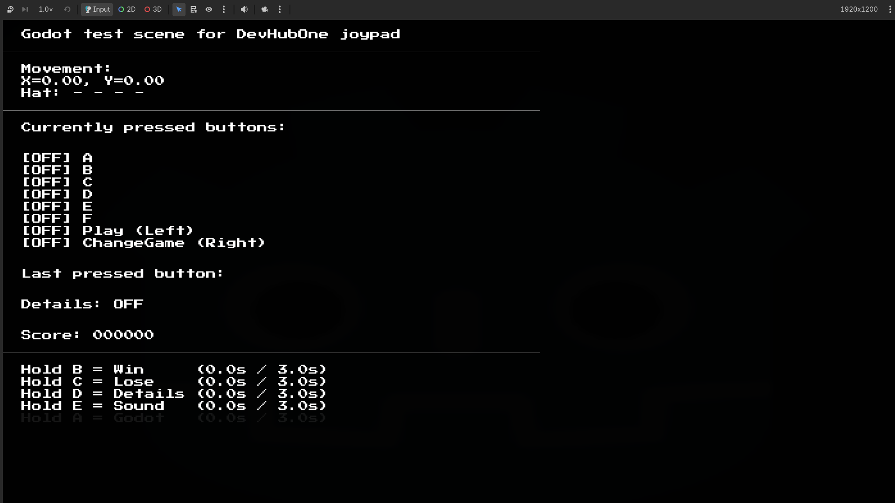

# DHO Arcade Godot Addon

## Description
This is a Godot plugin that gives access to predefined input actions for [DevHubOne](https://www.devhubone.com/en)'s joypad, scenes used in DevHubOne's arcade and API classes for anyone who needs a deeper integration with the joypad in the game they are developing.


*The joypad test scene*

---
## Table of Contents
- [Installation](#installation)
- [Getting started](#getting-started)
- [Input capture](#input-capture)
- [Joypad API (advanced)](#joypad-api-advanced)
- [Plugin settings](#plugin-settings)
- [Scenes](#scenes)
- [Switching between scenes](#switching-between-scenes)
- [Localization](#localization)
- [Credits](#credits)


## Installation
Go to the [Godot asset library](https://godotengine.org/asset-library/asset/5605) and download there or download this plugin manually from the [git repo](https://github.com/alemaki/DHO_arcade_addon) and copy the whole `addons/dho_arcade_addon` folder into the `addons` folder of your project. After that go to <code> Project -> Project Settings -> Plugins </code> and enable this plugin. Restart the editor so any changes to the project can load properly.

## Getting started
After downloading the plugin and enabling it you can take a look at the newly defined input actions in your project in <code>Project -> Project Settings -> Input Map</code>. There are also a few autoloads that will work in the background.


## Input capture
The actions are mapped to DevHubOne's joypad like this (some of them are built-in):

| DHO button | Action name |                            Joypad button event name                            |
|------------|-------------|--------------------------------------------------------------------------------|
| A          | "ui_accept" | Joypad Button 3 (Top Action, Sony Triangle, Xbox Y, Nintendo X)                |
| B          | "ui_back"   | Joypad Button 1 (Right Action, Sony Circle, Xbox B, Nintendo A)                |
| C          | "ui_c"      | Joypad Button 0 (Bottom Action, Sony Cross, Xbox A, Nintendo B)                |
| D          | "ui_d"      | Joypad Button 2 (Left Action, Sony Square, Xbox X, Nintendo Y)                 |
| E          | "ui_e"      | Joypad Button 9 (Left Shoulder, Sony L1, Xbox LB)                              |
| F          | "ui_f"      | Joypad Button 10 (Right Shoulder, Sony R1, Xbox RB)                            |
| PLAY       | "ui_play"   | Joypad Button 6 (Start, Xbox Menu, Nintendo +)                                 |
| EXIT       | "ui_exit"   | Joypad Button 4 (Back, Sony Select, Xbox Back, Nintendo -)                     |

| Joystick | Action name |                Joypad button event name             |
|----------|-------------|-----------------------------------------------------|
| left     | "ui_left"   | Joypad Axis 0 - (Left stick Left, Joystick 0 Left)  |
| right    | "ui_right"  | Joypad Axis 0 + (Left stick Right, Joystick 0 Right)|
| up       | "ui_up"     | Joypad Axis 1 - (Left stick Up, Joystick 0 Up)      |
| down     | "ui_down"   | Joypad Axis 1 + (Left stick Down, Joystick 0 Down)  |

To get input information just capture the action mappings:
```
var axis_X: float = Input.get_axis("ui_left", "ui_right")
var axis_Y: float = Input.get_axis("ui_up", "ui_down")
var is_A_pressed: bool = Input.is_action_pressed("ui_accept")
var is_B_just_pressed: bool = Input.is_action_just_pressed("ui_back")
```

Easy as it gets. Feel free to get the direct movement input with:
```
var input_left: float = Input.get_action_strength("ui_left") # for example
```

If you wish to create a game that works both with keyboard and the DHO's joypad you can map your keyboard variants to those actions.

WARNING: DO NOT USE `Input.get_vector` like this:
```
var input_direction := Input.get_vector("ui_left", "ui_right", "ui_up", "ui_down")
```
As of currently (6th November 2026), in Godot 4.x, joypad inputs will result with some error along the axis that is not pressed when calling the Input.get_vector with combination of keyboard input.
Issue to resolve: https://github.com/godotengine/godot/issues/90515#issuecomment-2616602880

### Creating your own input actions
You can create your own input actions and map them yourself with their respective input event names given in the table above. You are not required to use the ones provided in the plugin.

However, deleting the default ones provided by the plugin will require changing the plugin's scenes input actions. Do at your own discretion.

### Multiple devices (e.g. 2 or more joypads)
Any mention of input actions above is a description for "all devices" actions. Each input action has its mirror for a single device with the same name with appended "\_device_[num]" (devices are 0-counted) string at the end. For example: 
| action for all devices | action for device 0 | action for device 1|
|-|-|-|
| "ui_accept" | "ui_accept_device_0" | "ui_accept_device_1" |
| "ui_left" | "ui_left_device_0" | "ui_left_device_1" |


If you want to create a game with single player, by all means use the general actions. However, if you wish to create a game that uses multiple DevHubOne's joypads you might have to use the more targeted actions, the Joypad API or define your own.

If you plan on handling more than 2 devices look at [Plugin settings](#plugin-settings).

## Joypad API (advanced)
Skip this section if you are planning on using only the predefined input actions stated above!

The class `DHOJoypad` handles raw input from the joypads and keeps tabs on what was pressed and how long it was pressed. It also has useful signals to attach to.

`DhoJoypad` is an autoloaded node (of type `DHOJoypad`). You can disable it if you won't use it, but be warned: removing this autoload will break the `dho_joypad_test.tscn` scene.

You can capture input from `DhoJoypad` signals:
```GDScript
DhoJoypad.dho_button_pressed.connect(<your function(button, device)>)
DhoJoypad.dho_button_released.connect(<your function(button, device)>)
```

You can access the other functions:
```GDScript
var is_pressed: bool = DhoJoypad.is_button_pressed(<button>, <device number>)
var hold_time: float = DhoJoypad.get_button_hold_duration_sec(<button>, <device number>)
```

For axes:
```GDScript
DhoJoypad.dho_joystick_changed.connect(<your function(device)>) # emits normalized input
var input_vec: Vector2 = DhoJoypad.get_input_vector() 
var n_input_vec: Vector2 = DhoJoypad.get_normalized_input_vector()
```

## Plugin settings
The plugin adds new settings in `Project -> Project Settings -> General -> DHO -> Arcade`. If you do not see it, turn on  `Advanced Settings`:
- `Game Start Scene` - your game's starting scene. The scenes in the plugin will look at it to switch to. You must set this setting if you are going to use the plugin's provided scenes.
- `Is Zero Score Saved` - Set this to false if you do not wish to count 0-scores as new highscores in your game.
- `Max Devices Handled` - Default is 2. When setting this to a bigger value it will create new actions for you and map the new joypads. However, you have to restart the editor to see the changes in the project's settings.

## Scenes
The scenes are made for 1920 x 1200 resolution a.k.a. WUXGA (Widescreen Ultra Extended Graphics Array). DevHubOne's arcade works with this resolution. You should set your game's resolution to WUXGA.

Provided scenes:
- `dho_main.tscn` - Set this as your main scene in `Project -> Project Settings -> General -> Application -> Run -> Main Scene`. It displays your game's title and a scoreboard with the best scores (or nothing if no scores recorded). It will change to the `Game Start Scene` when action "ui_accept" is pressed (joypad A button).
- `dho_save_score.tscn` - It will handle setting the player's name, saving their score and switching to win/lose scene afterwards. If the new score is not a top 10 highscore, it will switch directly to win/lose scene without saving anything.
- `dho_win_lose.tscn` - This scene shows a text for win and lose. Then it will switch to either the main scene or the `Game Start Scene`, depending on the button press.
- `dho_exit_trigger.tscn` - Autoloaded by the plugin. It's an UI Node that stays hidden until the "ui_exit" action is pressed. If it is pressed twice in quick succession, this scene will trigger an exit of the game. `dho_exit_trigger.tscn` is required for DevHubOne's arcade.
- `dho_joypad_test.tscn` - This scene is only meant for you to test the joypad on your own device. It is not meant to be included in your game.

## Switching between scenes

Switch to the `dho_save_score.tscn` scene when the game is over with:
```GDScript
DHOSceneManager.switch_to_save_score_scene(<scene_tree>, <score>, <is_win>)
```

Switch to the `dho_win_lose.tscn` scene when the game is over and you do not want to save scores with:
```GDScript
# score is just for display. Won't show if 0 and `is_zero_score_saved` is set to false.
DHOSceneManager.switch_to_win_lose_scene(<scene_tree>, <score>, <is_win>)
```

Example:
```GDScript
# In some node, when player wins...:
DHOSceneManager.switch_to_save_score_scene(self.get_tree(), player.score, true)
```

## Localization
The classes below are a part of the plugin's scenes. You can make use of them, however I would recommend against it in a game jam setting, because you won't need localization.
- `DHOLocalizedText`: This class stores localized keys and writes them in the given format.
- `DHOLocalizedLabel`: This class sets a label with localized text.
- `DHOBlinkingLabel`: This class sets a blinking label with localized text
- `DHOScoreLabel`: You can use this score label in your games to show the player's score. See how in the score_saver or win_lose scene.

## Credits
[Alexander Makedonski](https://github.com/alemaki)

## License
The MIT License (MIT)

Copyright (c) 2026 Alexander Makedonski
