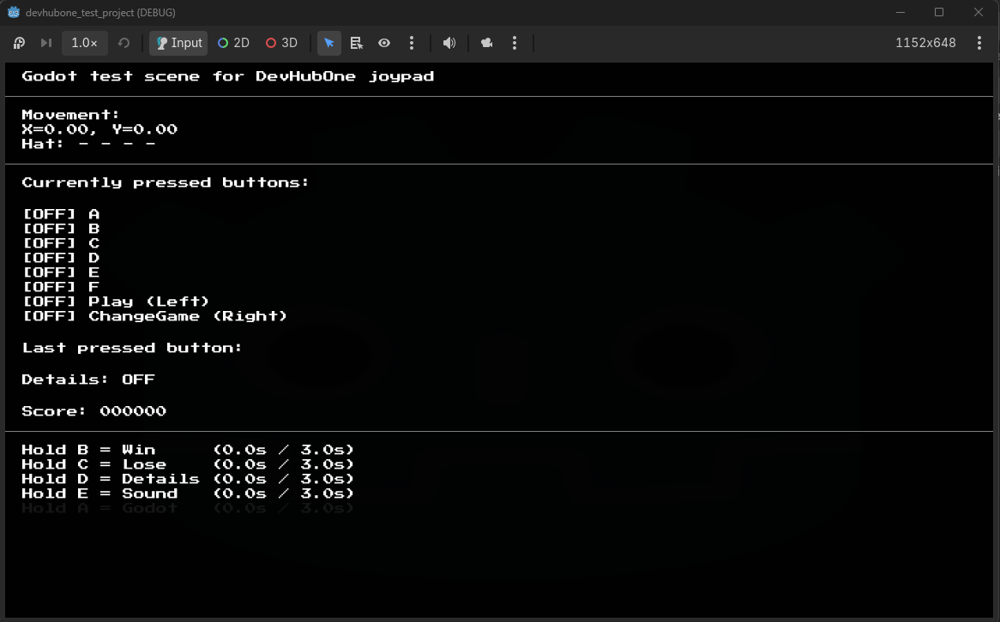

# DHO Arcade Godot Addon

## Description
This is a Godot plugin that gives access to predefined input actions for [DevHubOne](https://www.devhubone.com/en)'s joypad, scenes used in DevHubOne's arcade and API classes for anyone who needs a deeper integration with the joypad in the game they are developing.


*The joypad test scene*

---
## Table of Contents
- [Installation](#installation)
- [Getting started](#getting-started)
- [Input capture](#input-capture)
- [Joypad API (advanced)](#joypad-api-advanced)
- [Scenes](#scenes)
- [Passing information between scenes](#passing-information-between-scenes)
- [Localization](#localization)
- [Credits](#credits)


## Installation
Go to ...[TODO] the Godot asset library and download there or download this plugin manually from the [git repo](https://github.com/alemaki/DHO_arcade_godot_addon) and copy the whole `addons/dho_arcade_godot_addon` folder into the `addons` folder of your project. After that go to <code> Project -> Project Settings -> Plugins </code> and enable this plugin. Restart the editor so any changes to the project can load properly.

## Getting started
After downloading the plugin and enabling it you can take a look at the newly defined input actions in your project in <code>Project -> Project Settings -> Input Map</code>. There are also a few autoloads that will work in the background.


## Input capture
The actions are mapped to DevHubOne's joypad like this (some of them are built-in):

| DHO button | Action name |                            Joypad button event name                            |
|------------|-------------|--------------------------------------------------------------------------------|
| A          | "ui_accept" | Joypad Button 3 (Top Action, Sony Triangle, Xbox Y, Nintendo X)                |
| B          | "ui_back"   | Joypad Button 1 (Right Action, Sony Circle, Xbox B, Nintendo A)                |
| C          | "ui_c"      | Joypad Button 0 (Bottom Action, Sony Cross, Xbox A, Nintendo B)                |
| D          | "ui_d"      | Joypad Button 2 (Left Action, Sony Square, Xbox X, Nintendo Y)                 |
| E          | "ui_e"      | Joypad Button 9 (Left Shoulder, Sony L1, Xbox LB)                              |
| F          | "ui_f"      | Joypad Button 10 (Right Shoulder, Sony R1, Xbox RB)                            |
| PLAY       | "ui_play"   | Joypad Button 6 (Start, Xbox Menu, Nintendo +)                                 |
| EXIT       | "ui_exit"   | Joypad Button 4 (Back, Sony Select, Xbox Back, Nintendo -)                     |

| Joystick | Action name |                Joypad button event name             |
|----------|-------------|-----------------------------------------------------|
| left     | "ui_left"   | Joypad Axis 0 - (Left stick Left, Joystick 0 Left)  |
| right    | "ui_right"  | Joypad Axis 0 + (Left stick Right, Joystick 0 Right)|
| up       | "ui_up"     | Joypad Axis 1 - (Left stick Up, Joystick 0 Up)      |
| down     | "ui_down"   | Joypad Axis 1 + (Left stick Down, Joystick 0 Down)  |

To get input information just capture the action mappings:
```
var axis_X: float = Input.get_axis("ui_left", "ui_right")
var axis_Y: float = Input.get_axis("ui_up", "ui_down")
var is_A_pressed: bool = Input.is_action_pressed("ui_accept")
var is_B_just_pressed: bool = Input.is_action_just_pressed("ui_back")
```

Easy as it gets. Feel free to get the direct movement input with:
```
var input_left: float = Input.get_action_strength("ui_left") # for example
```

If you wish to create a game that works both with keyboard and the DHO's joypad you can map your keyboard variants to those actions.

WARNING: DO NOT USE `Input.get_vector` like this:
```
var input_direction := Input.get_vector("ui_left", "ui_right", "ui_up", "ui_down")
```
As of currently (6th November 2026), in Godot 4.x, joypad inputs will result with some error along the axis that is not pressed when calling the Input.get_vector with combination of keyboard input.
Issue to resolve: https://github.com/godotengine/godot/issues/90515#issuecomment-2616602880

WARNING:
Deleting those actions will require you to reload the plugin to have them again. The test scene for the joypad works with the raw input and won't break if the defaults have been removed. However the asset scenes provided in this plugin work with input actions, so you will have to change the scenes and include your own actions.

### Creating your own input actions
You can create your own input actions and map them yourself with their respective input event names given in the table above. You are not required to use the ones provided in the plugin.


### Multiple devices (e.g. 2 or more joypads)
Any mention of input actions above is a description for "all devices" actions. Each input action has its mirror for a single device with the same name with appended "\_device_[num]" (devices are 0-counted) string at the end. For example: 
| action for all devices | action for device 0 | action for device 1|
|-|-|-|
| "ui_accept" | "ui_accept_device_0" | "ui_accept_device_1" |
| "ui_left" | "ui_left_device_0" | "ui_left_device_1" |


If you want to create a game with single player, by all means use the general actions. However, if you wish to create a game that uses multiple DevHubOne's joypads you might have to use the more targeted actions, the Joypad API or define your own.

Just in case you plan on making a game with more than 2 joypads connected :
- Increase `MAX_DEVICES_HANDLED` in `DHOJoypad`as you like and reload the plugin. It will create new actions for you and map the joypads.
## Joypad API (advanced)
Skip this section if you are planning on using only the predefined input actions stated above!

`DhoJoypad` is the autoloaded node (of type `DHOJoypad`) of this plugin.

You can capture input from `DhoJoypad` signals like:
```GDScript
DhoJoypad.dho_button_pressed.connect(<your function(button, device)>)
DhoJoypad.dho_button_released.connect(<your function(button, device)>)
```
There is also a small API which can also be accessed like :
```GDScript
var is_pressed: bool = DhoJoypad.is_button_pressed(\<button>, \<device number>)
var hold_time: float = DhoJoypad.get_button_hold_duration_sec(\<button>, \<device number>)
```
For axes:
```GDScript
DhoJoypad.dho_joystick_changed.connect(<your function(device)>) # emits normalized input
var input_vec: Vector2 = DhoJoypad.get_input_vector() 
var n_input_vec: Vector2 = DhoJoypad.get_normalized_input_vector()
```

WARNING: Disabling the autoload of this node (or disabling the plugin) will BREAK the joypad test scene provided by this plugin.

## Scenes

- `dho_scoreboard.tscn` - Set this as your main scene. It requires you to set a scene for your game to switch to in the `start_scene` var in the root node. It will change the scene when action "ui_accept" is pressed (joypad A button). It is not required for the start scene to inherit `DHOScene` class, however it is recommended.
- `dho_save_score.tscn` - Switch to this scene when the game is over and pass it the `DHOSceneContext` (using `DHOSceneManager` or `DHOWinLoseEvent`). It will handle setting the player's name, saving their score and switching to win/lose scene afterwards. If the new score is not a top 10 highscore, it will switch directly to win/lose scene without saving anything.
- `dho_win_lose.tscn` - If you do not want to have scores in your game, switch directly to this scene. Otherwise, switch to `dho_save_score.tscn`. This scene will have a `play_again_scene` var. This should be the path to the same start scene in `dho_scoreboard.tscn`.
- `dho_exit_trigger.tscn` - Autoloaded by the plugin. It's an UI Node that stays hidden until the "ui_exit" action is pressed. If it is pressed twice in quick succession, this scene will trigger an exit of the game. `dho_exit_trigger.tscn` is required for DevHubOne's arcade.
- `dho_joypad_test.tscn` - This scene is only meant for you to test the joypad on your own device. It is not meant to be included in your game.

## Passing information between scenes

### `DHOSceneContext` Resource
A resource for managing information between scenes. You pair this with `DHOScene` node to pass game information between scenes, however it's not required. You will have to pass `DHOSceneContext` to the plugin's scenes so they will work properly.

The data fields below are required for those scenes. You can edit the fields in your own game to keep track of information then pass it to other DHO scenes from the plugin. They will take care of the information for you after that.

| Field | Description |
|-------|-------------|
| `score` | How much the player scored. Keep value between 0 and 999999. |
| `is_win` | Before changing the scene set this to `true` if player won. Otherwise, set to `false`. |

Add other information for your scenes as you see fit. Or even better: extend this class.

### How to switch to score_saving scene or win/lose scene
#### 1. You can use `DHOSceneManager` directly
This is a static class that contains a method for changing scenes for DevHubOne's arcade.

The function you will mostly need:
```
change_scene(current_node, to_path, context) # For scenes that are DHOScene nodes
change_scene_to_path(current_node, to_path) # For any scene
```

You can read what this function does in the file `scripts/dho_scene_manager.gd`.

#### 2. You can use `DHOWinLoseEvent`
You can use this node to switch to a different `DHOScene`. Normally when the game ends you should switch to the save_score.tscn. You can do whatever you want, though. Set `is_win` before switching to save_score or win_lose scene to know if the player won or lost.

NOTE: This node requires a current `DHOScene`. If not set, it will search for it.

Call `execute()` when ready to change scene.

## Localization
The classes below are a part of the plugin's scenes. You can make use of them, however I would recommend against it in a game jam setting, because you won't need localization.
- `DHOLocalizedText`: This class stores localized keys and writes them in the given format.
- `DHOLocalizedLabel`: This class sets a label with localized text.
- `DHOBlinkingLabel`: This class sets a blinking label with localized text
- `DHOScoreLabel`: You can use this score label in your games to show the player's score. See how in the score_saver or win_lose scene.

## Credits
[Alexander Makedonski](https://github.com/alemaki)

## License
The MIT License (MIT)

Copyright (c) 2026 Alexander Makedonski

Permission is hereby granted, free of charge, to any person obtaining a copy of this software and associated documentation files (the "Software"), to deal in the Software without restriction, including without limitation the rights to use, copy, modify, merge, publish, distribute, sublicense, and/or sell copies of the Software, and to permit persons to whom the Software is furnished to do so, subject to the following conditions:

The above copyright notice and this permission notice shall be included in all copies or substantial portions of the Software.

THE SOFTWARE IS PROVIDED "AS IS", WITHOUT WARRANTY OF ANY KIND, EXPRESS OR IMPLIED, INCLUDING BUT NOT LIMITED TO THE WARRANTIES OF MERCHANTABILITY, FITNESS FOR A PARTICULAR PURPOSE AND NONINFRINGEMENT. IN NO EVENT SHALL THE AUTHORS OR COPYRIGHT HOLDERS BE LIABLE FOR ANY CLAIM, DAMAGES OR OTHER LIABILITY, WHETHER IN AN ACTION OF CONTRACT, TORT OR OTHERWISE, ARISING FROM, OUT OF OR IN CONNECTION WITH THE SOFTWARE OR THE USE OR OTHER DEALINGS IN THE SOFTWARE.
